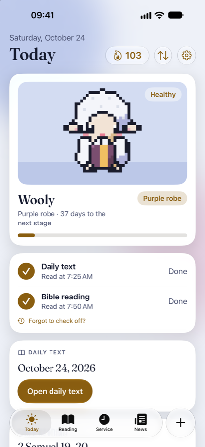
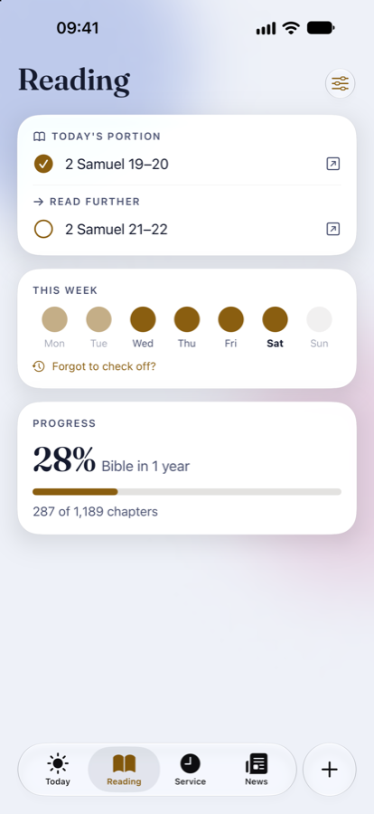
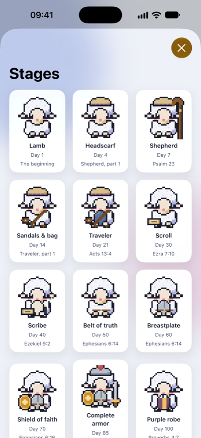
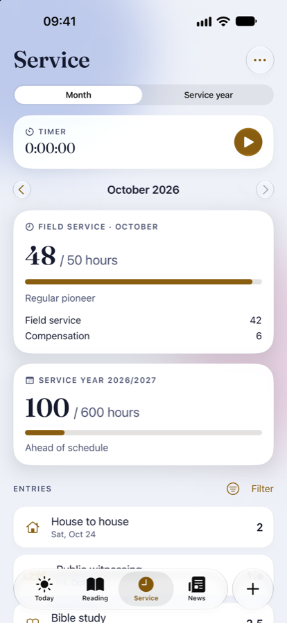

  

  

<h1 align="center">Manna</h1>

  <strong>Daily text, Bible reading and field service — with a companion that grows with your streak.</strong>

  
  
  
  

  <a href="index.md">Support &amp; FAQ</a> ·
  <a href="privacy.md">Privacy policy</a> ·
  <a href="mailto:studionjvapps@gmail.com">Contact</a>

---

## About

Manna helps you make time for Jehovah's Word every day. The daily text, your Bible reading schedule and your field service hours are together in one calm, beautiful app — with a cheerful pixel-art companion that grows as long as you keep reading.

  
  
  
  

## Features

### 📖 Daily text
Open today's daily text on jw.org with one tap and check it off once you have read it.

### 📚 Daily Bible reading
- Based on the official reading schedule: the whole Bible, the history of Israel, the Christian congregation, or by category
- Your own pace: the Bible in 1 to 7 years
- Already reading? Start at the book and chapter where you are now
- The schedule waits for you — skip a day and simply continue where you left off
- Read further, or mark that you read something else today
- Progress in percent and chapters

### 🐑 Your companion and streak
- Choose a dog, cat or sheep and give it a name
- Grows through 16 stages, from shepherd and traveler to the complete armor and paradise
- Forgot to check off? You can still do so up to three days back
- Finished your schedule? Celebrate, set a new goal or take a break while your companion sleeps
- Prefer no streak? Simply switch it off

### ⏱️ Field service
- Timer with Live Activity and Dynamic Island, or quick entry
- Monthly goals for auxiliary pioneer, regular pioneer, special pioneer and circuit overseer, or your own goal
- Optional yearly goal with an "on schedule" indicator for the service year
- Compensation for theocratic assignments and schools, within the 55-hour monthly limit

### 📰 News
The latest news from jw.org, with an optional notification when something new is published.

### ✨ Made for you
- Choose the modules you use
- Four themes in light and dark: Night Blue, Aubergine & Gold, Desert Sand and Olive & Honey
- Widgets for the Home Screen, Lock Screen and Control Center
- Reminders at the times you choose
- Syncs across your devices with iCloud
- Designed for every iPhone — including iPhone Duo — and iPad

## Privacy

Manna does not collect your data. Everything stays on your device and in your own iCloud account. No ads, no analytics, no tracking. Read the full [privacy policy](privacy.md).

## Support

Questions, problems or ideas? See the [support page](index.md) or email **studionjvapps@gmail.com**.

---

  Made with care by Studio NJV. 
  Manna is an independent app and is not affiliated with or endorsed by the Watch Tower Bible and Tract Society or Jehovah's Witnesses.

